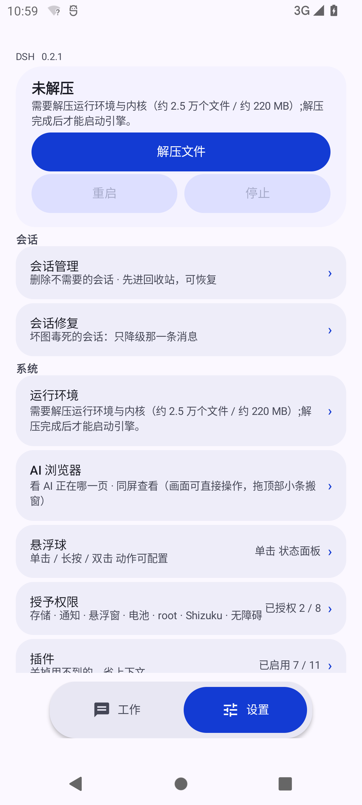
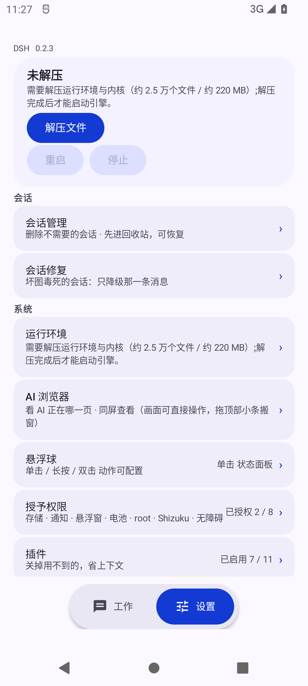
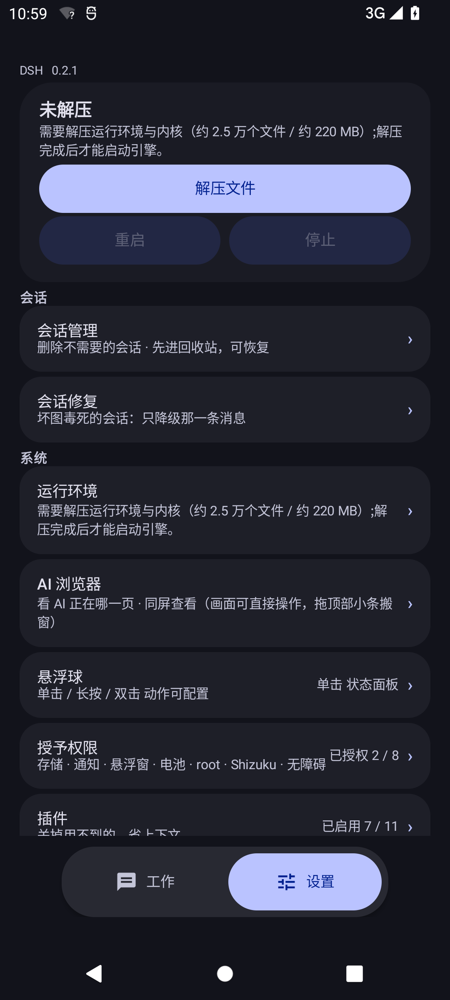
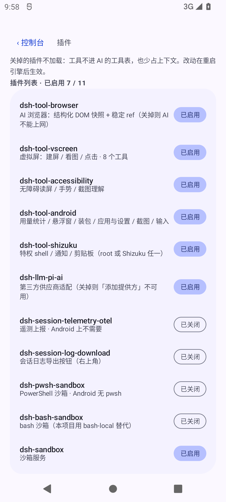

# TokiDSH

TokiDSH 把 DeepSeek Harness（DSH）打包成可直接安装的 Android APK——装上就能用，并且让 AI **免 Root 真正操作手机**。

运行内核是 `@deepseek-ai/dsh`（0.2.1-rc.2），界面按 Material Design 3 Expressive 重构。

## 界面

| 工作台 | 控制台 | 控制台（深色） |
| --- | --- | --- |
|  |  |  |

| 插件开关 | 会话管理 | 主题 |
| --- | --- | --- |
|  |  |  |

> 截图来自 Android 11 模拟器；`sessions.png` / `theme.png` 待补。

## 工作台

- 底栏左侧「工作」进入 DSH 原生前端（WebView），右侧「设置」进入原生控制台
- WebView 与底栏上下分栏，聊天输入框不会被底栏压住
- 切换标签只做显隐、不重载页面，聊天上下文与滚动位置都保留
- 引擎未启动时点「工作」会提示先到「设置」里启动

## 控制台（设置）

- **引擎**：解压运行环境、启动 / 重启 / 停止、端口与文件数、日志
- **权限**：存储、通知、悬浮窗、电池、root / Shizuku、无障碍，逐项授权
- **插件**：11 个内置插件的开关，关掉的不加载、省上下文
- **日志**：查看 / 分享 `dsh-web.log`
- **主题**：外观、布局、文案全部由 `console.json` 决定，可导入导出主题包
- **会话**：会话管理（回收站 / 彻底删除）、会话修复（只降级单条坏附件）
- **自检**：内核清单式一致性检查 + 自愈账本
- **救援**：安全模式启动、导出 / 导入全部数据
- **运行环境**：重新解压（修混装树）、我的补丁（保存 / 清空自定义内核文件）

## 手机端插件

| 插件 | 能力 |
| --- | --- |
| `dsh-tool-shizuku` | 特权 shell：任意系统命令，异步执行、环境消毒、dex 只读自愈 |
| `dsh-tool-android` | 结构化系统操作：包管理、应用启停、系统设置、截图、模拟输入 |
| `dsh-tool-accessibility` | 无障碍读屏 + 点击 / 输入 / 滚动 / 截图理解（不需要 root / Shizuku） |
| `dsh-tool-vscreen` | 虚拟屏：建屏、把 App 启动到虚拟屏、看画面、点击滑动按键 |
| `dsh-tool-browser` | AI 浏览器：结构化 DOM 快照 + 稳定 ref + 差分 + 动作后校验，支持多页签 |

三条通道互补：特权通道做系统级操作，无障碍通道免授权读屏交互，虚拟屏让 AI 不打扰主屏地跑自动化。

## 权限与数据

- 系统操作需要 [Shizuku](https://shizuku.rikka.app/)（免 Root）或 root；不授予也能正常聊天和读写文件
- API Key 在 App 内填写，只存本机，不会打包进 APK
- 数据外置在 `/sdcard/DeepSeekHarness/`，卸载重装不丢会话、插件与补丁

## 安装

从 [Releases](https://github.com/ichiyotsu/TokiDSH/releases) 下载 `DSH-0.1.0.apk`：

- 包名 `com.deepseek.harness`，端口 3080
- Android 7.0（API 24）及以上
- 使用本仓库的发布签名（`CN=DSH`）；装过上游 1.x 的设备需先卸载

版本规则：正式版 `DSH x.y.z`、共存版 `DSH x.y.z-beta`、兼容版 `DSH x.y.z-And`，同版本号的三套包作为一批一起发。

## 构建

需要 Android SDK（build-tools + platform android.jar）、JDK 17+、Node 与 DSH 开发环境（`runtime/` + `dshroot/`）：

```sh
cd android-app
export DSH_DEV_HOME=/path/to/devhome      # 含 runtime/ dshroot/ .dsh/
export KEYSTORE_PASS=... KEYSTORE_ALIAS=dsh
sh build.sh
```

`build.sh` 会组装 payload、注入移动端样式、编译 dex、对齐并签名，产物是 `android-app/DeepSeekHarness.apk`。

## 设计

Material Design 3 Expressive：品牌蓝 `#4D6BFE` 生成的完整色板（浅 / 深两套角色）、不对称大圆角卡片、药丸按钮与胶囊开关、surface 分层替代描边、M3 字阶与三档弹性动效。组件形态参考 [TokiNote](https://github.com/ichiyotsu/TokiNote)，用 Java drawable + CSS 手写实现。

## 已知限制

1. WebView 需要 Chromium 94+；更老的系统请用兼容版（暂未随本仓库发布）
2. 本仓库只发正式版；`-beta` / `-And` 两个包按批次另行发布
3. 与上游 1.x 签名不同，无法覆盖升级
4. 虚拟屏需要 Shizuku 或 root，且与另一套实例同时运行时会争用 8999 端口

## 致谢与许可

- [DeepSeek Harness](https://github.com/deepseek-ai)（`@deepseek-ai/dsh`）：运行内核
- [woaiys3/deepseek-harness-android-app](https://github.com/woaiys3/deepseek-harness-android-app)：Android 打包与移动端适配的源头
- [Shizuku](https://github.com/RikkaApps/Shizuku)（Apache-2.0）：免 Root 特权通道
- [Operit](https://github.com/AAswordman/Operit)（LGPL-3.0）：虚拟屏相关实现
- [TokiNote](https://github.com/ichiyotsu/TokiNote)：M3 Expressive 设计体系参考

主体代码采用 MIT；虚拟屏相关文件沿用 LGPL-3.0，详见 [THIRD_PARTY_NOTICES.md](THIRD_PARTY_NOTICES.md)。
